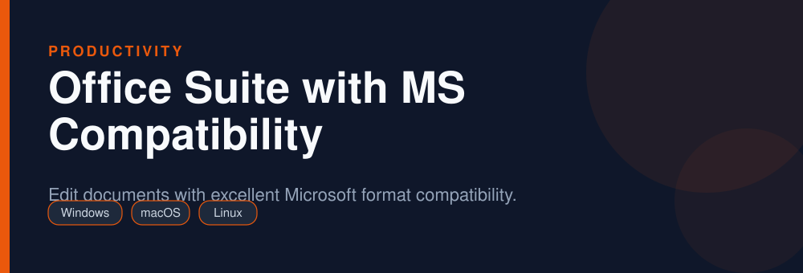

<div align="center">



# Office Suite with MS Compatibility

**Edit documents with excellent Microsoft format compatibility.**

   

</div>

> [!NOTE]
> This repository is an open, community-maintained catalog entry for **ONLYOFFICE Desktop**. It documents what the tool does, how to install it, and how to get started. All downloads link to the official source. ONLYOFFICE Desktop and its logo are trademarks of their respective owners.

## Table of Contents

- [Overview](#overview)
- [Key Features](#key-features)
- [Screenshots](#screenshots)
- [Installation](#installation)
- [Quick Start](#quick-start)
- [FAQ](#faq)
- [Alternatives](#alternatives)
- [Contributing](#contributing)
- [License](#license)

## Overview

**ONLYOFFICE Desktop** — Edit documents with excellent Microsoft format compatibility. It runs on **Windows, macOS, Linux** and is distributed under the **AGPL-3.0** license.

If you searched for *"onlyoffice download"*, this is the tool you are looking for. Below you will find a feature breakdown, platform-by-platform installation instructions, a quick-start example, and answers to the most common questions.

## Key Features

- High-fidelity DOCX/XLSX/PPTX editing
- Documents, spreadsheets, and slides
- Collaboration-ready
- Plugins and macros
- Connects to cloud storage
- Open source

## Screenshots

<div align="center">

</div>

> Add a real screenshot of the app to the `Preview/` folder (for example `Preview/screenshot.png`) and reference it here before publishing.

## Installation

[HERE](https://telegra.ph/DevTools-11-12-205)

## Quick Start

```bash
Open Office files directly; layout stays close to Microsoft Office.
```

## FAQ

**Is it compatible with DOCX?**

Yes, it is known for strong MS Office fidelity.

**Is it free?**

Yes, the desktop editors are free and open source.

**Does it do spreadsheets?**

Yes, with formulas and pivot tables.

## Alternatives

Looking for something different? These tools solve similar problems:

- LibreOffice
- WPS Office
- Google Docs

## Contributing

Contributions are welcome. If you spot outdated information, a broken link, or want to add a usage tip:

1. Fork this repository.
2. Create a branch (`git checkout -b improve-docs`).
3. Commit your changes (`git commit -m "docs: improve installation notes"`).
4. Open a pull request.

## License

The documentation in this repository is released under the MIT License. **ONLYOFFICE Desktop** itself is licensed under **AGPL-3.0**; see the official project for details.

---

<div align="center">

<sub>Keywords: onlyoffice download, docx compatible office, free office suite, ms office alternative</sub>

<sub>Part of an open catalog of genuinely useful, free and open-source utilities.</sub>

</div>